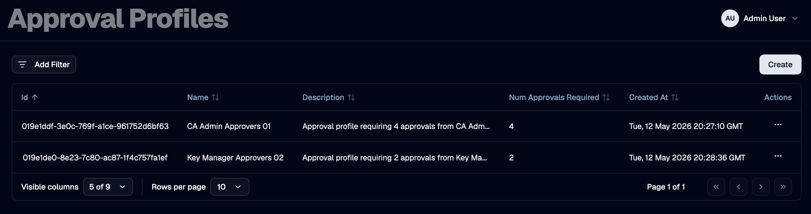
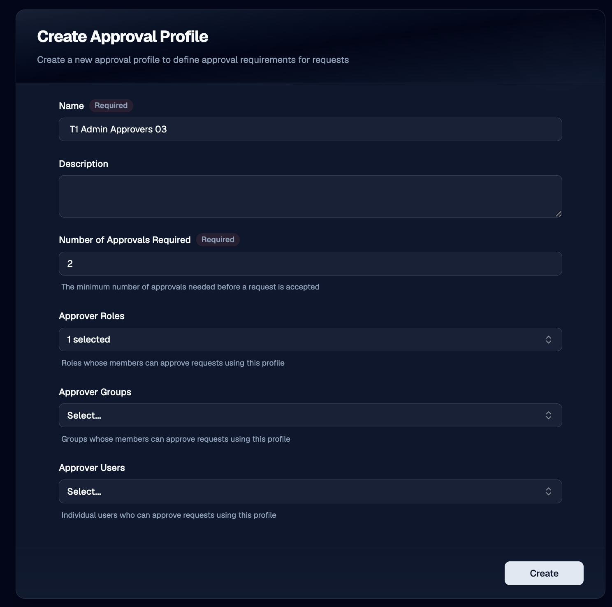
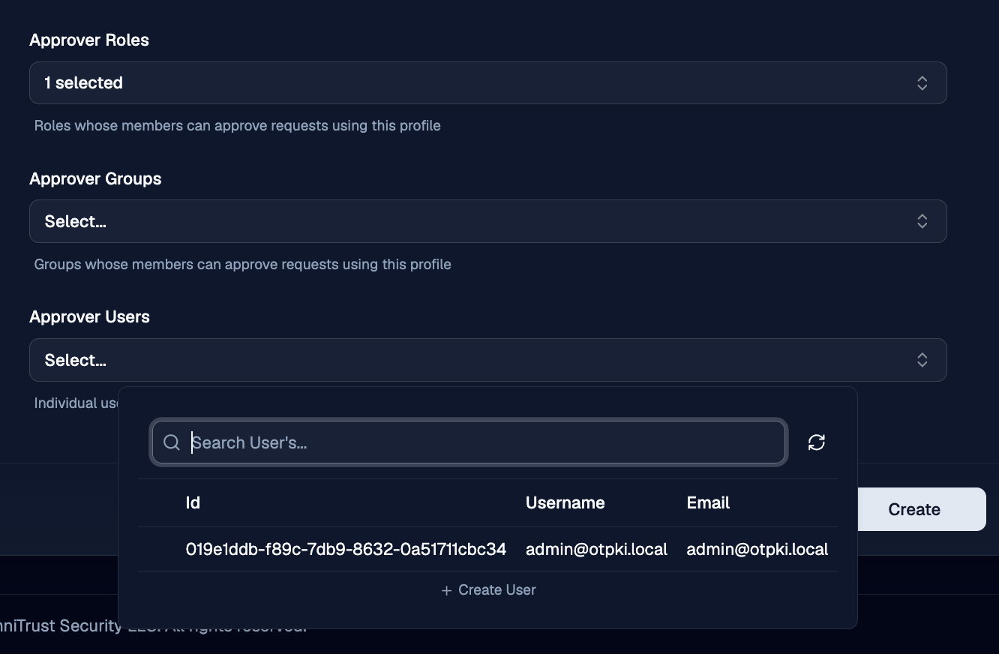
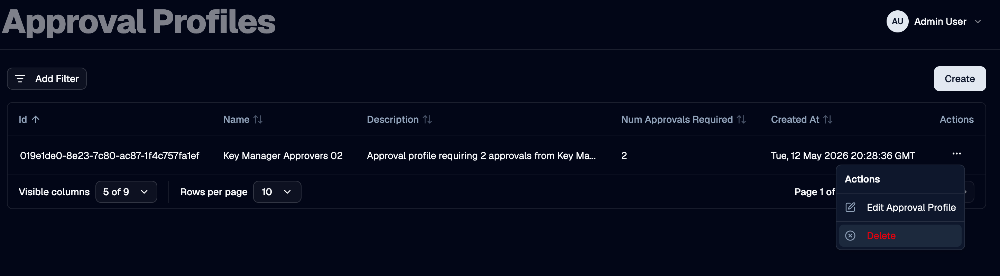

An **approval profile** defines who can approve a gated operation and how many approvals are needed before the operation can proceed.

Approval profiles are reusable. A single profile can be attached to multiple end entity profiles, certificate profiles, and certificate authorities, so the same approver pool governs every operation that references it.

Approval profiles do not themselves perform any action. They are referenced from the resources whose operations should be gated, and OTPKI consults the reference at request time to decide whether to defer the request as a [work item](./work-items) for approval.

## Approval Profile List

The Approval Profiles page lists every approval profile defined in OTPKI and provides entry points for creating, viewing, editing, and deleting them.

## Create / Edit Approval Profile

Use the create form to define a new approval profile, or the edit form to update an existing one.

### Name

Use **Name** to give the approval profile a clear identifier that operators can recognize when assigning it to an end entity profile, certificate profile, or certificate authority. Names must be at least three characters long.

### Description

Use **Description** to record the intent of the approval profile, such as the risk level it covers or the policy that requires it.

### Number of Approvals Required

Use **Number of Approvals Required** to set how many distinct approver actions must be recorded before a work item bound to this profile is considered approved. The value must be at least one. Each authorized approver can record only one approval per work item; reaching the configured threshold transitions the work item from **Pending** to **Approved** and lets the gated request continue.

### Approvers

OTPKI authorizes an approver if they match any of the three approver collections defined on the profile. A user is allowed to approve a work item if they are listed directly, belong to one of the listed groups, or hold one of the listed roles.

#### Approver Users

Use **Approver Users** to authorize specific user accounts to approve work items bound to this profile.

#### Approver Groups

Use **Approver Groups** to authorize every member of the selected groups to approve work items bound to this profile.

#### Approver Roles

Use **Approver Roles** to authorize every user that holds the selected roles to approve work items bound to this profile.

:::caution
If an approval profile is saved with **no** approver users, groups, or roles configured, no one will be authorized to approve work items that reference it. Any operation bound to that profile will remain stuck in **Waiting for Approval** until the profile is updated.
:::

## Where Approval Profiles Are Used

Approval profiles are referenced from three resources, each gating a different
phase of the certificate lifecycle:

| Resource | Field | Triggers approval for |
| --- | --- | --- |
| [End Entity Profile](../../enrollment/end-entity-profiles) | Approval Profile | Enrollment requests against the profile (both new end entities and re-enrollments of existing ones) |
| [Certificate Profile](../../issuance-and-revocation/certificate-profiles) | Approval Profile | Issuance requests that use this certificate profile |
| [Certificate Authority](../../issuance-and-revocation/certificate-authorities) | Approval Profile | Issuance requests signed by this CA |

When more than one of these references applies to the same operation, OTPKI evaluates them in order - see [Enrollment Requests](./enrollment-requests) and [Issuance Requests](./issuance-requests) for the per-request flow.

## Delete Approval Profile

Deleting an approval profile removes it from the approval profile list. Resources that still reference the profile must be updated to point at a different profile (or to clear the reference) before deletion, otherwise operations against those resources can no longer be approved.

