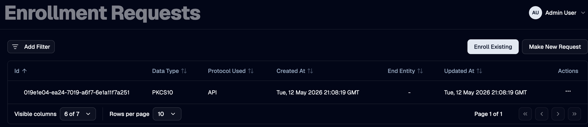

An **enrollment request** is the operation OTPKI performs when a new or existing end entity submits a CSR (or other supported request payload) to be issued a certificate. When the targeted end entity profile has an [approval profile](./approval-profiles) assigned, OTPKI does not act on the request immediately - it parks the enrollment, marks the end entity as **Waiting for Approval**, and creates a [work item](./work-items) for the configured approvers.

## Enrollment Request List

The Enrollment Requests page lists every enrollment request OTPKI has recorded, including its protocol, end entity, and current status.

## How Approval Is Triggered

OTPKI checks the **Approval Profile** field on the end entity profile that the request is enrolling against. If the field is set, the request is gated:

1. OTPKI persists the enrollment request and sets the end entity status to **Waiting for Approval**.
2. OTPKI creates a work item bound to the end entity profile's approval profile, with the resource type set to **Enrollment Request** and the resource ID set to the new enrollment request.
3. The request's response carries the enrollment request ID but no certificate - callers can poll the request to observe its state change once approval completes.

> If the end entity profile does not have an approval profile assigned, OTPKI skips this gate and proceeds directly to issuance.

## End Entity Status During Approval

| End Entity Status | Meaning |
| --- | --- |
| **Waiting for Approval** | Enrollment is paused. A work item is awaiting approver action |
| **New** | The enrollment was approved (or did not require approval). OTPKI has started or completed handing the request off to issuance |
| **Generated** | A certificate has been issued and stored against the end entity |
| **Failed** | Issuance failed, or the enrollment work item was rejected |
| **Revoked** | The end entity (and its certificates) have been revoked |

> OTPKI only accepts a fresh enrollment for an existing end entity when its status is **New**, **Generated**, or **Failed**. An end entity in **Waiting for Approval** cannot have another enrollment request submitted against it until the existing work item is resolved.

## What Happens When the Work Item Is Approved

When approvers reach the **Number of Approvals Required** on the bound approval profile, OTPKI:

1. Sets the work item status to **Approved**.
2. Transitions the end entity status from **Waiting for Approval** to **New**.
3. Submits an issuance request to the issuer service using the stored enrollment data, certificate template, and end entity.
4. If the resulting issuance is also gated (because the targeted certificate profile or certificate authority has its own approval profile), the issuance request itself becomes a separate work item; see [Issuance Requests](./issuance-requests).
5. Once issuance completes, OTPKI stores the resulting end entity certificate and updates the end entity status to **Generated**.

## What Happens When the Work Item Is Rejected

When an authorized approver rejects the work item, OTPKI:

1. Sets the work item status to **Rejected**.
2. Sets the end entity status to **Failed**.

> The end entity remains in OTPKI in the **Failed** state so the request and its history are retained for audit purposes. A new enrollment can later be submitted against the same end entity.

## Looking Up an Enrollment Request

Use the request detail view to inspect a specific enrollment request, including its end entity, the protocol used, the linked issuance request (if any), and the certificate that was eventually issued.
