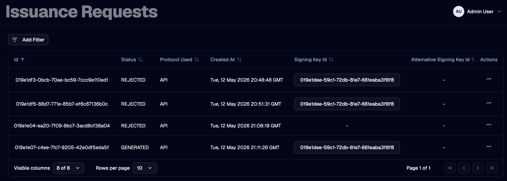

An **issuance request** is the operation OTPKI performs when its issuer service is asked to sign a certificate using a specific certificate profile and certificate authority. Issuance requests come from two sources:

- Directly, when an operator or integration submits an issuance request against a certificate profile and CA.
- Indirectly, when an approved [enrollment request](./enrollment-requests) hands off to the issuer to actually issue the end entity certificate.

In either case, OTPKI can hold the issuance request behind one or two layers of approval, depending on which of the targeted certificate profile and certificate authority reference an [approval profile](./approval-profiles).

## Issuance Request List

The Issuance Requests page lists every issuance request OTPKI has recorded, including its protocol, signing key, target CA, and current status.

## How Approval Is Triggered

When an issuance request is submitted, OTPKI inspects both the targeted certificate profile and the certificate authority signing the request:

1. If the **certificate profile** has an **Approval Profile** assigned, OTPKI sets the issuance request status to **Waiting for Approval** and creates a work item bound to the certificate profile's approval profile.
2. Otherwise, if the **certificate authority** has an **Approval Profile** assigned, OTPKI sets the issuance request status to **Waiting for Approval** and creates a work item bound to the CA's approval profile.
3. If neither has an approval profile assigned, OTPKI proceeds to sign the certificate immediately and the issuance status moves to **Generated**.

> The work item resource type is **Issuance Request** and the resource ID points to the persisted issuance request.

## Sequential Approval: Certificate Profile, Then CA

When **both** the certificate profile **and** the certificate authority have approval profiles assigned, OTPKI enforces approval in sequence:

1. The first work item is created against the **certificate profile's** approval profile.
2. When that work item reaches **Approved**, OTPKI counts the number of approved issuance work items for the request. Because the CA also requires approval, the request needs two approved work items in total, so OTPKI creates a second work item - this one bound to the **CA's** approval profile.
3. Once the second work item reaches **Approved**, OTPKI signs the certificate and transitions the issuance request to **Generated**.

> If either work item is rejected, the issuance request transitions to **Rejected** and no certificate is issued.

## Issuance Request Status

| Issuance Status | Meaning |
| --- | --- |
| **Waiting for Approval** | One or more work items are pending against the request. |
| **New** | The request has cleared all approval gates and is about to be signed. This state is transient and is not typically observed in the UI. |
| **Generated** | The certificate has been signed and persisted. |
| **Failed** | The signing operation failed after approval cleared. |
| **Rejected** | An approver rejected one of the work items gating the request. |

## What Happens When the Final Work Item Is Approved

When the last required work item for an issuance request reaches **Approved**, OTPKI:

1. Re-loads the persisted issuance request, certificate profile, certificate authority, and (if specified) target certificate authority.
2. Signs the certificate using the configured signing key and chain.
3. Stores the issued certificate and updates the issuance request status to **Generated**.
4. If the request was created on behalf of an [enrollment request](./enrollment-requests), OTPKI also stores the certificate against the end entity and transitions the end entity to **Generated**.
5. If the request specified a target certificate authority (for example, when issuing a subordinate CA certificate), OTPKI attaches the issued certificate and its chain to that CA.

## What Happens When a Work Item Is Rejected

When an authorized approver rejects any of the work items gating an issuance request, OTPKI sets the issuance request status to **Rejected**. The certificate is not signed, and no further work items are created for the request.

If the issuance request originated from an enrollment request, the enrollment's end entity is also moved to **Failed**.

## Looking Up an Issuance Request

Use the request detail view to inspect a specific issuance request, including its certificate template, signing key, target CA, and once approved and signed, the resulting issued certificate.
