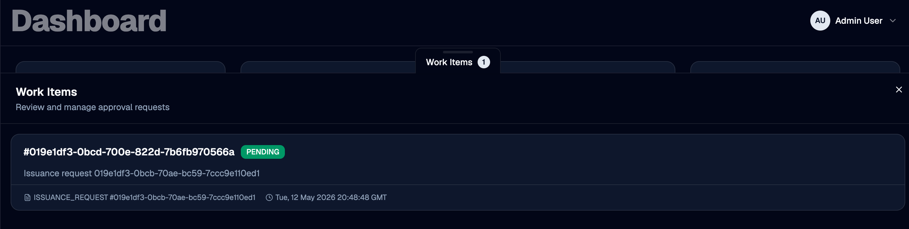
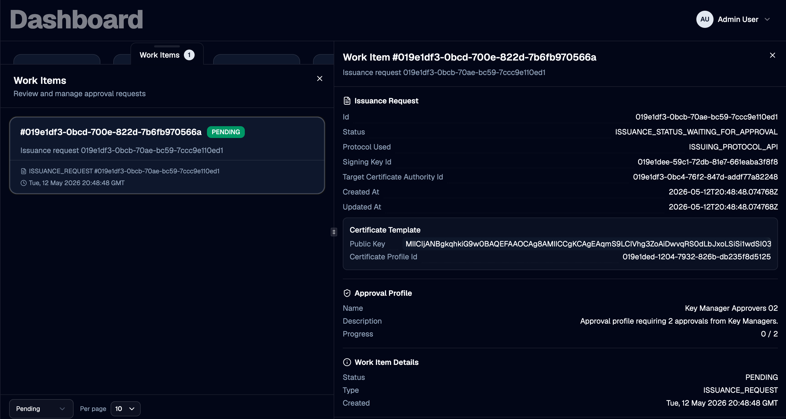

A **work item** is the unit of work an approver acts on. OTPKI creates a work item whenever a request is made against a resource that references an [approval profile](../approval-profiles). The work item records which approval profile governs the decision, which underlying resource (an enrollment request or an issuance request) is waiting, and which approver users have already signed off.

Approvers do not interact with the underlying enrollment or issuance request directly. They review and resolve the work item, and OTPKI then advances the gated request on their behalf once the approval threshold is met.

## Work Item List

The Work Items page lists every work item OTPKI has created, including its status and the resource it is gating.

## Work Item Detail

Selecting a work item opens its detail view, where authorized approvers can review the gated request and record an approval or rejection.

### Approval Profile

Each work item is bound to exactly one approval profile. The profile determines who is allowed to approve and how many approvals are required for the work item to transition to **Approved**.

### Resource Type and ID

Each work item references the resource that triggered it. The resource type is one of:

- **Enrollment Request** - produced when a new or existing end entity is enrolled against an end entity profile that has an approval profile assigned. See [Enrollment Requests](../enrollment-requests).
- **Issuance Request** - produced when an issuance request targets a certificate profile or certificate authority that has an approval profile assigned. See [Issuance Requests](../issuance-requests).

The resource ID identifies the specific enrollment or issuance request the work item is gating. Approving or rejecting the work item drives that specific request to its next state.

### Description

A human-readable summary recorded by OTPKI when the work item is created (for example, the enrollment request ID and login ID, or the issuance request ID). Use it to scan the list and confirm you are acting on the correct request.

### Status

A work item moves through the following statuses:

| Status | Meaning |
| --- | --- |
| **Pending** | The work item is awaiting approval. Authorized approvers may approve or reject it. |
| **Approved** | The configured number of approvals has been reached. OTPKI advances the gated request to its next state. |
| **Rejected** | An authorized approver rejected the work item. OTPKI fails or rejects the gated request. |

> Only **Pending** work items can be acted on. OTPKI rejects approve and reject calls against work items that are already **Approved** or **Rejected**.

### Approvals

The detail view lists each user who has already approved the work item, along with the timestamp of their approval. OTPKI does not allow the same user to approve a work item more than once.

## Approving a Work Item

Use **Approve** to record your approval on a pending work item. OTPKI records the action under your user account and increments the approval count.

- If the approval count is now equal to the **Number of Approvals Required** on the bound approval profile, OTPKI sets the work item to **Approved** and advances the gated request - see [Enrollment Requests](../enrollment-requests) and [Issuance Requests](../issuance-requests) for what happens next per resource type.
- If the count is still below the threshold, the work item remains **Pending** and continues to wait for additional approvers.

> OTPKI rejects the approve action with an authorization error if your user is not listed in the approval profile's **Approver Users**, does not belong to any of its **Approver Groups**, and does not hold any of its **Approver Roles**.

## Rejecting a Work Item

Use **Reject** to deny a pending work item. A single rejection from any authorized approver transitions the work item to **Rejected** immediately and fails or rejects the underlying request.

OTPKI applies the same approver authorization check used for **Approve**.

## Checking Whether You Can Approve

For a given approval profile, OTPKI exposes a check that reports whether the currently signed-in user is an authorized approver. Administration UIs use this check to show or hide approve/reject controls on a work item before the user attempts the action.
