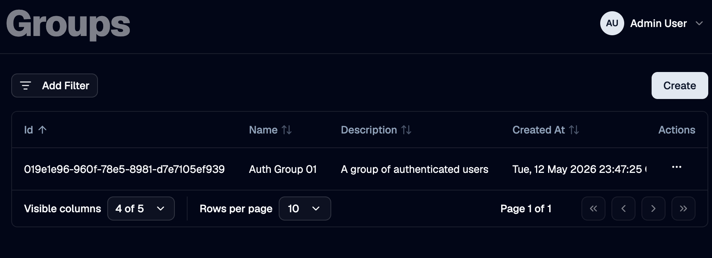
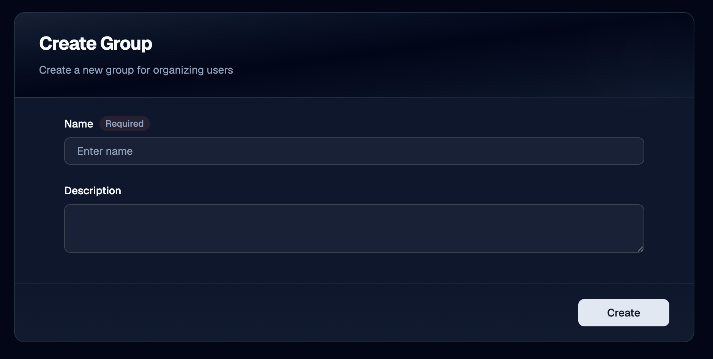

A **group** is a reusable collection of [users](../users). Groups are an organizational tool: they let you refer to a set of users by a single name in other parts of OTPKI.

> Groups do **not** grant permissions. To give a user access, assign a [role](../roles). For more on how access decisions are made, see [Permissions](../../permissions).

## Where Groups Are Used

Today, groups are consulted by [Approval Profiles](../../approval-workflows/approval-profiles), which can name a group as one of the approver collections that can act on work items. Any feature that gates an action by "anyone in this group" will reference groups defined on this page.

## Groups List

The Groups page lists every group defined in OTPKI. The list shows name, description, and when the group was created. The row menu lets you edit or delete a group.

## Create Group

Use the **Create** button to add a new group.

### Name

Use **Name** to give the group a unique identifier. Required, three to one hundred twenty-seven characters. Group names must be unique across OTPKI.

### Description

Use **Description** to record what the group is for, such as the team or function it represents.

## Edit Group

Use the row menu on the groups list to open the edit form. The fields are the same as on the Create form.

## Delete Group

Use the row menu on the groups list to delete a group. Deleting a group removes every user's membership in it and removes it from any feature that referenced it (for example, an approval profile that listed it as an approver collection).

## Managing Group Membership

Group membership is set on the **user**, not on the group. There are two places to manage it:

- On a single user's **Edit User** form (see [Users](../users)), in the **Groups** picker.
- On the [Permissions](../../permissions) screen, under the **User Assignments** tab. Select a user, then toggle group memberships from the **Group Memberships** card.

There is no member list directly on the group itself.

## Notes

- **Group names are unique.** Two groups cannot share a name.
- **Membership is on the user record.** Removing a group does not delete its users; removing a user does not delete the group.
- **Groups have no permissions of their own.** Anywhere OTPKI checks whether a user can do something, it consults the user's [roles](../roles), not their groups.
