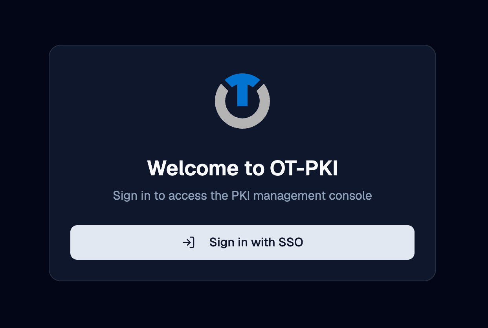
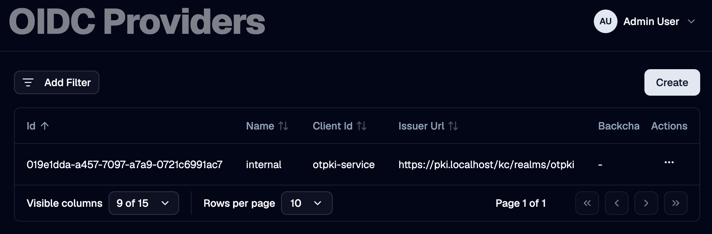

An **identity provider** is an external system that authenticates [users](./users) into OTPKI. OTPKI supports OpenID Connect (OIDC) providers, such as Keycloak, Okta, Entra ID (Azure AD), or any other compliant provider.

This page covers configuring OIDC providers, the sign-in experience, and the related authentication settings. Permissions are handled separately, on the [Permissions](../permissions/permissions) screen.

## Authentication Methods

OTPKI accepts two kinds of credentials:

- **Single sign-on through an OIDC provider.** The user is redirected to the configured provider, signs in there, and returns to OTPKI with a session.
- **Client certificate.** Mostly used by scripts, automation, and other non-browser callers. The certificate must be attached to an OTPKI user account (see [Users](./users)).

A single user account can hold both.

## Sign-in Flow

When a user lands on the sign-in page, OTPKI shows the configured identity providers. If more than one is configured, the user picks one from a dropdown and clicks **Sign in with SSO**. OTPKI redirects to that provider, the user authenticates there, and the provider returns them to OTPKI with the information needed to look up or create their account.

If no identity providers are configured, the sign-in page shows a message that authentication is not available and tells the user to contact an administrator.

## Signing in with a Client Certificate

Clients can authenticate with a certificate instead of signing in through an identity provider. This is mostly used by scripts, automation, and other non-browser callers.

Certificate authentication is handled by the deployment's ingress, not by OTPKI itself. The ingress terminates mutual TLS and forwards the client certificate to OTPKI. To use it, a client connects to the deployment's **mTLS endpoint**, which is a separate network address from the browser sign-on endpoint.

In the default stack, the gateway exposes:

| Listener | Default port | Purpose |
| --- | --- | --- |
| `https` | 443 | Browser traffic and single sign-on |
| `mtls` | 8443 | Client certificate authentication |

The exact host and port depend on how your deployment was installed. Check the deployment or networking documentation for the specific values in your environment. The expectation is the same regardless of how it is exposed: connect to the mTLS endpoint, present a certificate during the TLS handshake, and the ingress will forward it to OTPKI for the rest of the request.

For the certificate to actually authenticate as an OTPKI user, the user account must have that certificate attached. See [Users](./users) for how to upload a certificate to a user account. If OTPKI receives a certificate that is not attached to any existing user, it can create a new user automatically using the certificate's common name as the username.

## Identity Providers List

The Identity Providers page lists every OIDC provider configured in OTPKI. The list shows name, client ID, issuer URL, the discovery override (if any), the redirect URL, and the flags that control automatic creation of users and roles. The client secret is never shown in the list.

## Create Identity Provider

Use the **Create** button to register a new OIDC provider. You will need the provider's issuer URL, client ID, and client secret, plus the redirect URL that OTPKI will use after sign-in.

<!-- Side by side... the form is really long -->

  
  

### Name

Use **Name** to give the provider a unique label that operators recognize, such as `corporate-sso` or `keycloak-prod`. Required, three to one hundred twenty-seven characters. The name is what users see on the sign-in page.

### Client ID

Use **Client ID** to record the OAuth 2.0 client identifier issued by the provider when you registered OTPKI as an application there.

### Client Secret

Use **Client Secret** to record the matching client secret. The field is masked in the form.

### Issuer URL

Use **Issuer URL** to point OTPKI at the provider. OTPKI fetches the provider's OIDC discovery document and JSON Web Key Set from this URL.

### Backchannel URL

Use **Backchannel URL** only when your provider exposes discovery and back-channel endpoints at a path that differs from the issuer (for example, when reached through a reverse proxy). Leave empty in normal deployments.

### Redirect URL

Use **Redirect URL** to set the address the provider will redirect the user to after sign-in. OTPKI handles the callback at `/auth/callback`, so the value is typically `https://<your-otpki-host>/auth/callback`. This URL must also be registered as an allowed redirect URI in the provider's own configuration.

### Post-Logout URL

Use **Post-Logout URL** to set the address the provider will redirect the user to after sign-out. If left empty, users may be left on the provider's logout page after signing out of OTPKI.

### Scopes

Use **Scopes** to list the OIDC scopes OTPKI requests from the provider. At minimum include `openid`. Add `profile` and `email` to get the user's name and email back from the provider. Add a custom scope (such as `roles`) if the provider needs it to release the corresponding claims.

### Session Max Inactive

Use **Session Max Inactive** to set how long a session may sit idle before it expires. A user who has not made a request within this window will be required to sign in again.

### Session Max Length

Use **Session Max Length** to set the absolute maximum lifetime of a session, regardless of activity. After this much time has passed since sign-in, the user must sign in again.

### Create Unknown Users

Use **Create Unknown Users** to control what happens when somebody signs in through the provider for the first time:

- **Enabled** - OTPKI creates a [user](./users) account on first sign-in, using the claims from the provider.
- **Disabled** - the sign-in is refused if no matching user exists. Use this when you want to provision users manually.

### Create Unknown Roles

Use **Create Unknown Roles** to control what happens when a sign-in token contains role names OTPKI does not recognize:

- **Enabled** - OTPKI creates the missing [roles](./roles) on the fly. Auto-created roles appear with the **System** badge and start with no permissions until an administrator edits them on the [Permissions](../permissions/permissions) screen.
- **Disabled** - role names the provider sends that do not exist in OTPKI are silently ignored. Only roles that already exist in OTPKI are assigned to the user.

## Edit Identity Provider

Use the row menu on the providers list to open the edit form. The fields are the same as on the Create form.

## Delete Identity Provider

Use the row menu on the providers list to delete a provider. Users who were created through that provider remain in OTPKI but can no longer use it to sign in.

If only one provider is configured and you delete it, no one will be able to sign in through single sign-on. Make sure at least one administrator can authenticate by client certificate before removing the last provider.

## Claim Mapping

When a user signs in, OTPKI uses the following claims from the provider's token:

| Claim | Used as | Required |
| --- | --- | --- |
| `sub` | Stable identifier for the user account in OTPKI | Yes |
| `iss` | The provider that issued the token; must match a configured provider's issuer URL | Yes |
| `username` (or `preferred_username` as a fallback) | The user's OTPKI username on first sign-in | Yes |
| `given_name` | The user's first name | No |
| `family_name` | The user's last name | No |
| `email` | The user's email address | No |
| `roles` | The OTPKI roles to assign on each sign-in | No |

Make sure the requested **Scopes** include the ones your provider requires to release these claims (typically `openid profile email`, plus a custom scope for roles if needed).

## How User Records Stay in Sync

Every time a user signs in through a provider, OTPKI updates the matching user account from the claims in the new token. The following fields are refreshed:

- First name
- Last name
- Email
- Roles

> **Edits made in OTPKI to those fields will be overwritten on the user's next sign-in if the provider sends a different value.** To make a change stick, update the value in the provider itself, or stop requesting the scope that supplies the claim.

The user's **username**, **groups**, and any **attached certificate** are not touched on sign-in.

## Sign-out

The user menu in the page header has a **Sign out** option that ends the OTPKI session.

If the user signed in through an identity provider, OTPKI also asks the provider to end its session, then redirects the user to the provider's **Post-Logout URL**. Configure that URL on the provider to send users to a sensible landing page, such as the OTPKI sign-in page.

## Notes

- **Multiple providers are supported.** You can register as many OIDC providers as you need, and users see all of them on the sign-in page.
- **The redirect URL must be registered with the provider.** OTPKI cannot work around an OIDC provider that does not list the configured redirect URL as an allowed return target.
- **The client secret is required.** OTPKI uses it to exchange the authorization code for tokens and to introspect bearer tokens.
- **First sign-in versus later sign-ins.** A user's OTPKI account is created on first sign-in (when **Create Unknown Users** is enabled). On every later sign-in, the linked account is matched by the provider's `sub` and `iss` claims, and select fields are refreshed from the new token.
- **Provider names are unique.** Two providers cannot share a name.
