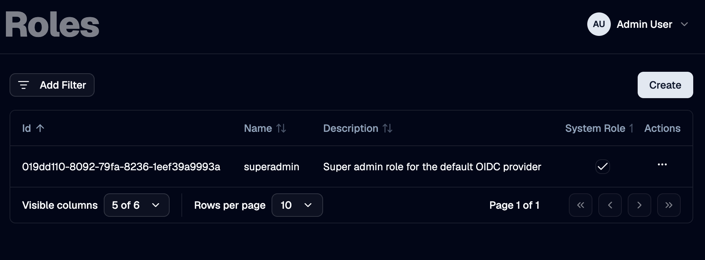
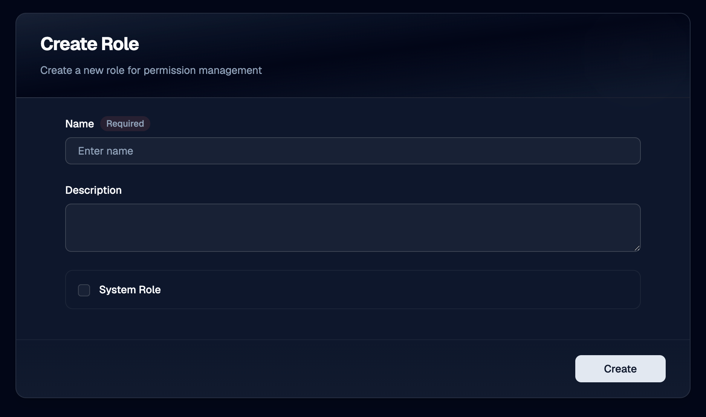

A **role** is a reusable bundle of permissions. Users get their access in OTPKI by holding one or more roles.

This section is reserved for managing roles in OTPKI. Ref by: [Permissions](../../permissions)

## Roles List

The Roles page lists every role defined in OTPKI. The list shows name, description, whether the role is a System role, and when it was created. The row menu lets you edit or delete a role.

System roles - the ones OTPKI ships with or auto-creates - are marked with a **System** badge.

## Create Role

Use the **Create** button to add a new role. Once the role exists, head to [Permissions](../../permissions) to populate the rules it grants.

### Name

Use **Name** to give the role a unique identifier. Required, three to one hundred twenty-seven characters. Role names must be unique across OTPKI.

### Description

Use **Description** to record what the role is for, such as the job function it represents.

## Edit Role

Use the row menu on the roles list to open the edit form. The fields are the same as on the Create form. You can edit the permissions a role grants on the [Permissions](../../permissions) screen.

## Delete Role

Use the row menu on the roles list to delete a role. Deleting a role removes its permissions and unassigns it from every user.

System roles cannot be deleted from the UI.

## System Roles

A few roles are marked as **System**:

- The **super-admin** role that OTPKI seeds at startup. Whoever holds this role can perform every action on every resource in the system.
- Any role that an [identity provider](../identity-providers) auto-creates from a sign-in claim, when the provider is configured to create unknown roles.

System roles still appear in the matrix on the [Permissions](../../permissions) screen and you can edit what they grant, but they cannot be added to or removed from users through the User Assignments tab.

## Notes

- **Role names are unique.** Two roles cannot share a name.
- **Permissions are edited elsewhere.** This screen is for managing the role records themselves. To change what a role can do, go to [Permissions](../../permissions).
- **Roles drive access.** A user with no roles has no permissions. Group membership alone never grants access.
