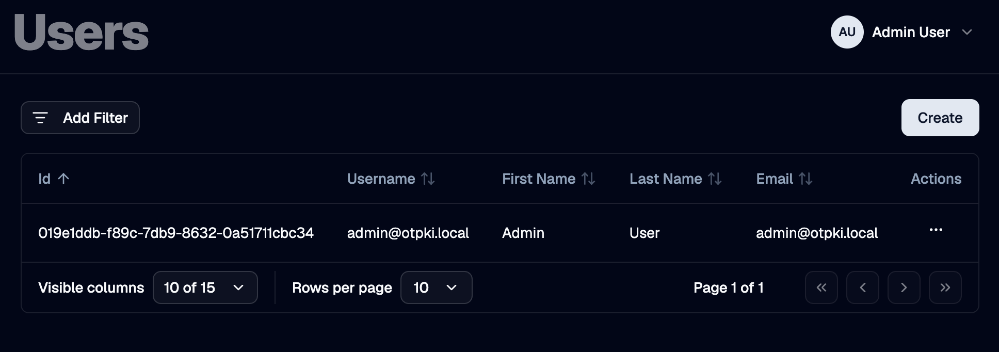
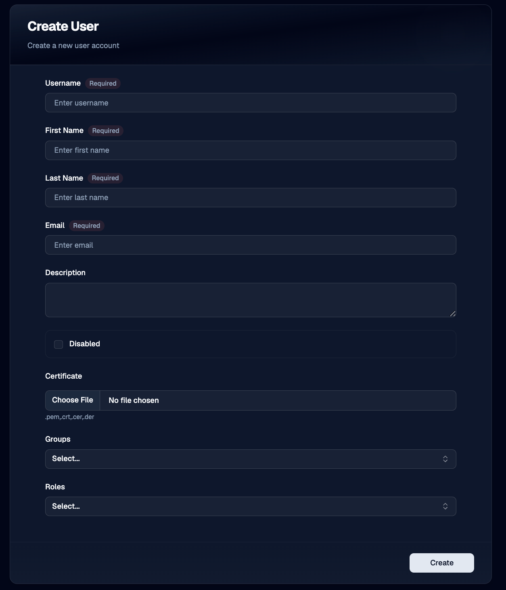
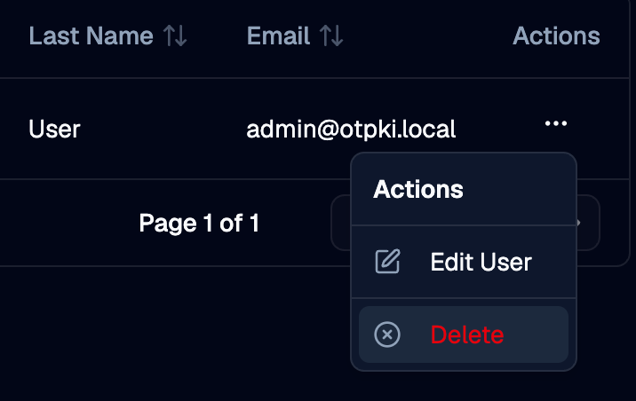

A **user** is an individual account that can sign in to OTPKI and take actions. OTPKI supports two ways for a user to authenticate: through a configured [identity provider](../identity-providers), or with a client certificate.

What a user is allowed to do is controlled by the [roles](../roles) assigned to them. See [Permissions](../../permissions) for how role permissions are configured and how role assignments are managed.

## Users List

The Users page lists every user account in OTPKI. The list shows username, name, email, whether the account is disabled, and when it was created. The row menu lets you edit or delete a user.

## Create User

Use the **Create** button to add a new user.

### Username

Use **Username** to give the user a unique identifier. Required, three to sixty-four characters. Usernames must be unique across OTPKI.

### First Name and Last Name

Use **First Name** and **Last Name** for the user's display name. Both are optional.

### Email

Use **Email** to record the user's address. Required and must be a valid email. Email addresses must be unique across OTPKI.

### Description

Use **Description** to record any extra notes about the user. Optional.

### Disabled

Use the **Disabled** toggle to block the user from authenticating. A disabled user cannot sign in regardless of any roles or permissions they hold. Disabled users still appear in lists with a **Disabled** badge so their history is preserved.

### Certificate

Use **Certificate** to upload an X.509 certificate that OTPKI will accept as proof of identity for this user. The upload accepts PEM and DER encodings (`.pem`, `.crt`, `.cer`, `.der`) up to 20 KB. Optional.

Each certificate can only be associated with one OTPKI user.

### Groups

Use **Groups** to add the user to one or more [groups](../groups). Group membership does not grant permissions on its own; it only affects features that key off groups, such as approval workflows.

### Roles

Use **Roles** to assign one or more [roles](../roles) to the user. Roles are what grant permissions. A user with no roles has no permissions, even if they belong to groups.

> **Roles and groups can also be managed in bulk.** The [Permissions](../../permissions) screen's **User Assignments** tab is a more convenient place to assign roles and groups to many users.

## Edit User

Use the row menu on the users list to open the edit form. The fields are the same as on the Create form.

Some fields on user accounts that authenticate through an [identity provider](../identity-providers) are managed by the provider and refresh on every sign-in. Edits you make to the user's first name, last name, email, or roles will be overwritten the next time the user signs in if the values from the provider differ. To make changes stick, update the values in the identity provider itself.

## Delete User

Use the row menu on the users list to delete a user. Deleting a user removes their access. Their historical records, including any audit entries and work item approvals, are preserved.

System users - the accounts OTPKI uses internally - cannot be deleted from the UI.

## How Users Authenticate

OTPKI accepts two forms of credentials for a user:

- **Single sign-on through an identity provider.** On first sign-in, OTPKI can create the user automatically and link it to the provider. Subsequent sign-ins match the same user by that link. See [Identity Providers](../identity-providers) for the full sign-in flow.
- **Client certificate.** If a user has a certificate attached, OTPKI accepts that certificate on requests sent through the mTLS endpoint. An unknown certificate can also auto-create a user, with the certificate's common name as the username.

A single user account can hold both.

## Notes

- **Usernames and emails are unique.** Reusing a username or email from a previously deleted user is not supported through the UI.
- **Disabling is preferred over deletion** when you want to revoke access temporarily. Disabled users keep their history; deleted users do not appear in lists.
- **The currently signed-in user** is shown in the page header, with a menu offering preferences and sign out.
