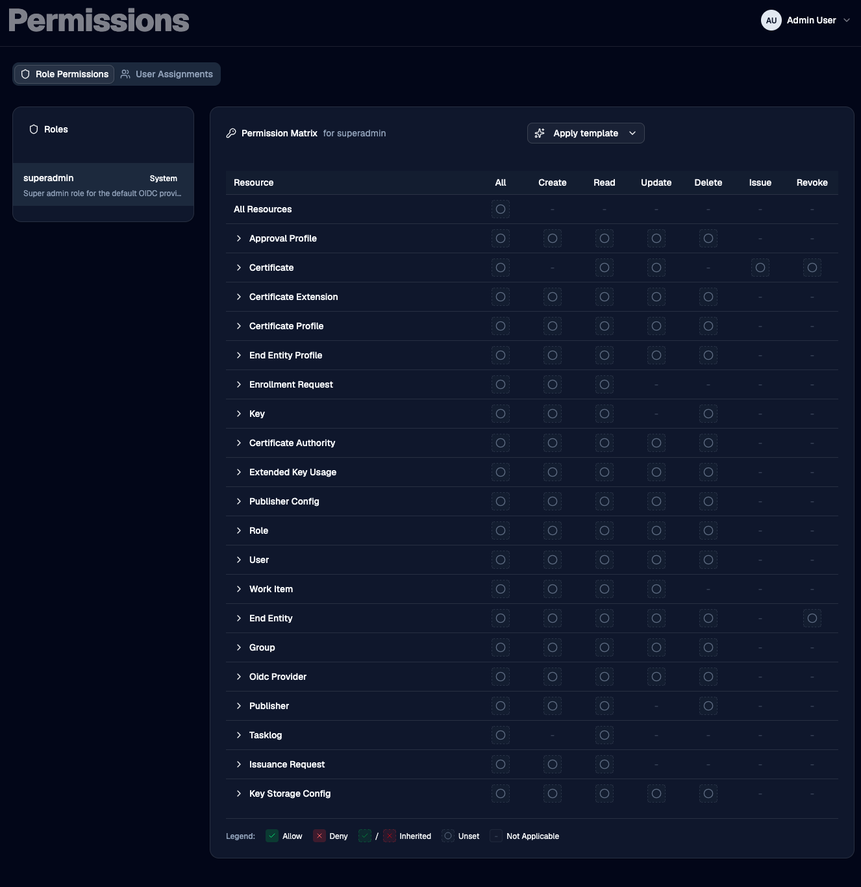
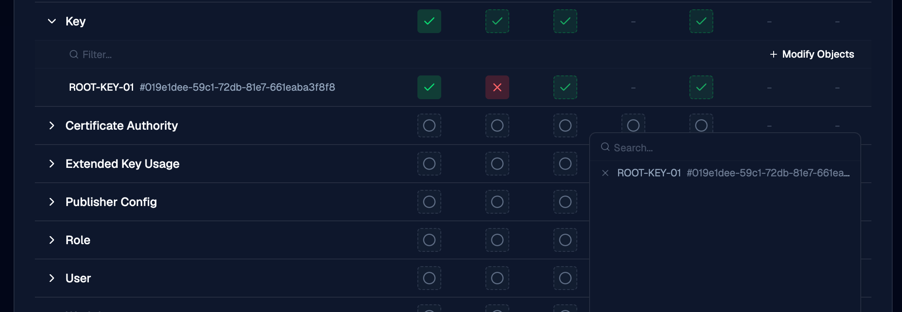
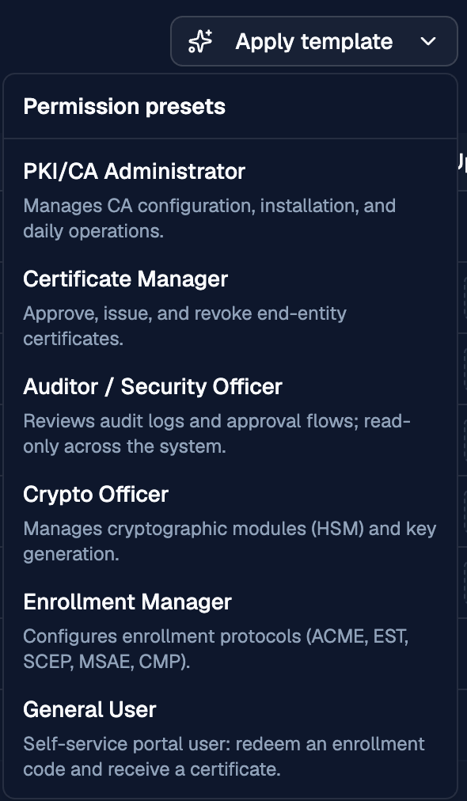
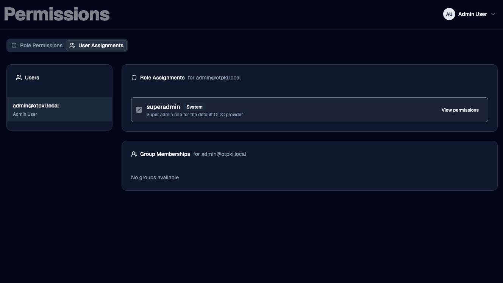

The Permissions screen is where you decide what each [role](../identity/roles) is allowed and not allowed to do, and which roles and [groups](../identity/groups) each [user](../identity/users) holds. OTPKI checks the resulting permissions every time a user tries to take an action.

## How Permissions Resolve

A **permission** is a single allow or deny rule with three optional dimensions:

- **Which resource?** For example, certificate authorities, certificate profiles, users, keys.
- **Which action on it?** For example, Create, Read, Update, Delete, Issue, Revoke.
- **Which specific object, if any?** For example, "this one CA" rather than "all CAs".

Any of those three can be left blank, which means "all of them". Permissions live on roles, so a user inherits the union of every rule attached to every role they hold.

When a user tries to do something, OTPKI looks at every permission their roles grant and picks the one that most closely matches the request. A rule about a specific object beats a rule about the whole resource, which in turn beats a wildcard "all resources" rule.

If two rules match equally closely - one allow and one deny - the **deny wins**. If you need to override a deny, write a more specific allow.

If no rule matches, the action is denied. Permissions start from a closed default.

> [Groups](../identity/groups) do **not** grant permissions. They only affect features that key off group membership, such as [approval profiles](../approval-workflows/approval-profiles).

## The Permissions Screen

The Permissions screen has two tabs:

- **Role Permissions** - edit what a role is allowed and not allowed to do.
- **User Assignments** - manage which roles and groups a user holds.

### Role Permissions

The left side lists every [role](../identity/roles). Select a role to load its permissions into the matrix on the right.

System roles - the ones OTPKI ships with - are marked with a **System** badge. You can edit a system role's permissions, but you cannot add or remove the role from users on the User Assignments tab.

#### Reading the Matrix

Each row is a resource. Each column is an action. The top row, **All Resources**, applies to every resource at once. The leftmost action column, **All**, applies to every action on that resource.

Click a cell to cycle through its possible states.

- **Allow** (green check) - the role can perform this action.
- **Deny** (red X) - the role is blocked from performing this action.
- **Inherited Allow / Inherited Deny** (faded, dashed check or X) - you haven't set this cell directly, but a broader rule covers it. The matrix shows the verdict that broader rule produces, so you can see how the cell would resolve as-is.
- **Unset** (empty circle) - no rule is stored here and no broader rule covers it.
- **Not Applicable** (single dash) - this action doesn't exist for this resource (for example, "Issue" only makes sense for certificates).

Clicking an Unset cell turns it Allow. Clicking again turns it Deny. Clicking again clears it back to Unset.

#### Granting Access to a Specific Object

Every resource row can be expanded. Expanding it opens an inline panel where you can grant or deny actions on **specific objects** of that resource - one specific certificate authority, one specific key, one specific user, and so on.

Use the **Modify Objects** button in the panel to search for objects and add them to the list. Once an object is in the list, it gets its own row of action cells that work just like the main matrix.

Object-level rules are the most specific kind of rule, so they override anything you've set at the resource or wildcard level. This is the right tool for cases like "this role can manage everything *except* this one production CA", or "this role can only issue on this one CA".

#### Templates

The **Apply template** dropdown at the top of the matrix replaces the role's permission set with a starting point that matches a common job. The current templates are:

- **PKI/CA Administrator** - manage CAs, profiles, custom extensions, EKUs, and publishers day-to-day; read access to keys and the task log.
- **Certificate Manager** - issue, revoke, and read certificates; review and act on issuance and enrollment requests and work items.
- **Auditor / Security Officer** - read-only across the system, plus the ability to manage approval profiles and act on work items.
- **Crypto Officer** - manage keys and key storage configurations; read CAs, certificates, and the task log.
- **Enrollment Manager** - manage the ACME, EST, MSAE, SCEP, and CMP protocol configurations and MSAE certificate templates; read the supporting profiles, CAs, and enrollment requests.
- **General User** - submit enrollment requests and read your own certificates. Suitable for self-service portal users.

Applying a template stages the change but does not save. Review the matrix, then **Save** or **Discard**.

#### Saving and Discarding

Edits to the matrix stay pending until you save. While you have pending changes, an **Unsaved changes** badge appears in the header along with **Save** and **Discard** buttons. Switching to a different role while you have pending edits prompts you to discard them first.

### User Assignments

The left side lists [users](../identity/users). Selecting a user reveals two cards:

- **Role Assignments** - check or uncheck a [role](../identity/roles) to assign or unassign it. Changes save immediately. System roles are visible but their checkbox is disabled so they can't be added or removed here. Each row also has a **View permissions** shortcut that jumps to the matrix for that role.
- **Group Memberships** - check or uncheck a [group](../identity/groups) to add or remove the user. Changes save immediately. Group membership does not change what the user can do here: see the note in [How Permissions Resolve](#how-permissions-resolve).

## Tips

- **A user with no roles has no access.** Group membership alone does not grant permissions.
- **Use object-level rules sparingly.** They are powerful, but they make a role harder to reason about. Prefer to model access with roles first and reach for object-level rules only when a role needs an exception.
- **Watch the inherited cells when editing.** The faded checks and Xs are showing you what the role will allow or deny based on the broader rules you've set. They're often easier to read than the explicit cells.
- **Deny is sticky.** When two equally specific rules disagree, deny wins. If a user "should" be able to do something but can't, look for a deny at the same or higher specificity.
